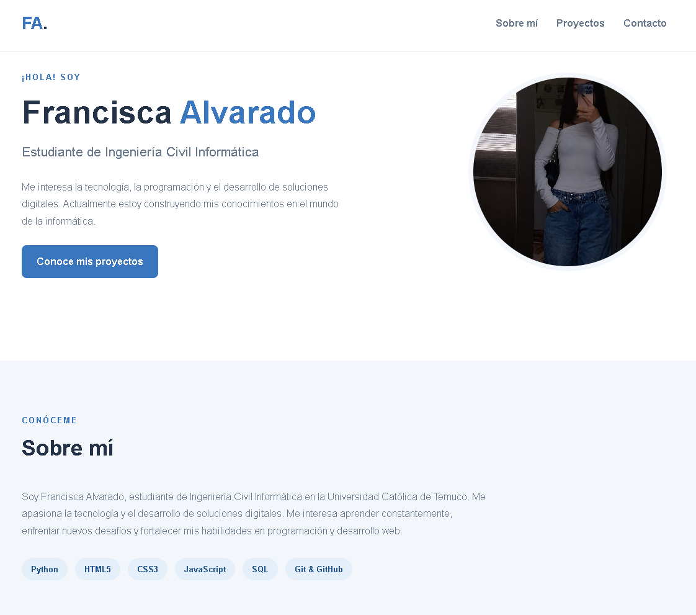

Portafolio Personal – Evaluación 4

Portafolio personal desarrollado con React, TypeScript y Vite, como continuación del proyecto realizado en la Evaluación 2 de la asignatura Desarrollo de Frontend.

El proyecto conserva la identidad visual del portafolio original y reorganiza su estructura utilizando componentes reutilizables, navegación entre páginas y consumo de una API REST.

Captura del proyecto original

La siguiente imagen muestra el portafolio desarrollado en la Evaluación 2, antes de su migración a React.

Tecnologías utilizadas

React: construcción de interfaces mediante componentes.

TypeScript: tipado estático para mejorar la organización y detectar errores.

Vite: herramienta de desarrollo y construcción.

React Router DOM: navegación entre páginas.

CSS3: estilos, diseño adaptable y metodología BEM.

Git y GitHub: control de versiones y almacenamiento del proyecto.

GitHub REST API: obtención de repositorios públicos.

Funcionalidades

Página de inicio con presentación personal.

Sección de proyectos desarrollados.

Página de contacto con enlaces de comunicación.

Navegación entre páginas mediante React Router.

Página 404 para rutas inexistentes.

Visualización de repositorios públicos de GitHub.

Estados de carga y error al consultar la API.

Diseño adaptable a distintos tamaños de pantalla.

Integración con GitHub REST API

El proyecto consume la API pública de GitHub para mostrar los repositorios del usuario.

Endpoint utilizado:

https://api.github.com/users/panxulita/repos?sort=updated&per_page=6

Parámetros:

sort=updated: ordena los repositorios según su última actualización.

per_page=6: limita la respuesta a seis repositorios.

Información presentada:

Nombre del repositorio.

Descripción.

Lenguaje principal.

Cantidad de estrellas.

Enlace al repositorio original.

La consulta se realiza de forma asíncrona mediante fetch, utilizando async/await. También se consideran los estados de carga y error, y la cancelación de la solicitud al desmontar el componente mediante AbortController.

Estructura del proyecto

Portafolio-React/
│
├── docs/
│   └── captura-e2.png
│
├── public/
│
├── src/
│   ├── assets/
│   │   └── perfil.jpg.jpeg
│   │
│   ├── components/
│   │   ├── Navbar/
│   │   ├── ProjectCard/
│   │   └── StatusMessage/
│   │
│   ├── context/
│   ├── data/
│   ├── hooks/
│   ├── pages/
│   ├── services/
│   ├── types/
│   │
│   ├── App.tsx
│   ├── App.css
│   ├── index.css
│   └── main.tsx
│
├── index.html
├── package.json
├── tsconfig.json
├── vite.config.ts
├── README.md
└── INVENTARIO.md

Instalación y ejecución

1. Clonar el repositorio

git clone https://github.com/panxulita/Portafolio-React.git

2. Entrar a la carpeta

cd Portafolio-React

3. Instalar dependencias

npm install

4. Ejecutar el servidor de desarrollo

npm run dev

Vite mostrará la dirección local para abrir el proyecto en el navegador.

5. Generar la versión de producción

npm run build

6. Previsualizar la versión de producción

npm run preview

Accesibilidad y diseño adaptable

Se utilizan elementos semánticos de HTML5, textos alternativos en imágenes, navegación mediante enlaces y estilos de foco para facilitar la interacción con teclado.

El diseño incluye reglas CSS responsivas para adaptar la presentación a diferentes tamaños de pantalla.

La auditoría de accesibilidad con Lighthouse y sus métricas deben completarse y registrarse después de ejecutar la evaluación correspondiente.

Autora

Francisca Alvarado
Ingeniería Civil Informática
Universidad Católica de Temuco

GitHub: https://github.com/panxulita